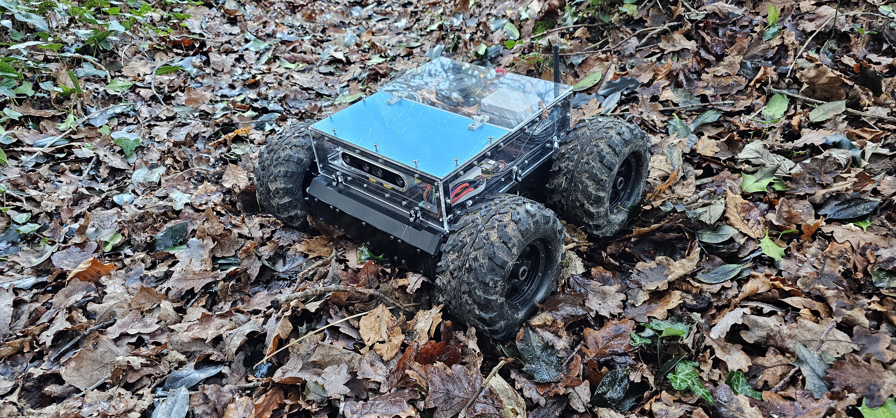

This is the main repository for NANA (Near-ground Autonomous Navigator for Arboreous Terrain), a low-cost autonomous forest navigation rover developed as a Group Design Project at the University of Southampton, commissioned by Professor Jadu Dash's remote sensing group. The core challenge is autonomous point-to-point navigation from a 15 cm viewpoint under forest canopy, with degraded GPS, limited look-ahead, and compliant vegetation indistinguishable from solid obstacles using geometry alone. Navigation combines geometric terrain analysis (RANSAC-based slope estimation) with semantic image segmentation (random forest classifier over four terrain classes) on depth and RGB frames from an Intel RealSense D455. The [wiki](https://github.com/Alp-1/NANA-Forest-Rover/wiki) contains further documentation on the rover's operation and configuration.

> **Note:**  Contributions to hardware, sensor integration, algorithm design and field work are not fully reflected in the commit history.

> **Note 2:** Some files are not publicly available due to university policy. Some links may also be broken as a result of the migration from the University of Southampton's GitLab instance.

## Research Poster


## The Directory Layout

    .
    ├── .vscode                 # VS Code settings
    ├── CAD Models              # CAD Models used in the project with attributions. 
    ├── ESP32                   # ESP32 code for ESP32-C3 dronebridge.
    ├── GPS                     # Script to start NTRIP caster.
    ├── low_level_control       # Low level control
    ├── lua_scripts             # Lua scripts uploaded in flight controller
    ├── navigation              # Autonomous navigation
    ├── pyrealsense             # Intel Realsense library required on Raspberry Pi
    ├── schematic               # Schematic of the low level controller
    ├── .gitignore
    ├── pyproject.toml          # Python dependencies
    └── README.md

### Installation
To run some code that are not hardware dependent on your local PC, you can run the following commands in Python (Version used: **3.10.5** in PC and Raspberry Pi):

(./ is the repo root directory)
```sh
$ pip install -e .
```



## Low Level Control
There are two components in the low level control i.e. the motor controller and the central hub. They are both implemented on the Raspberry Pi Pico using micropython. See the [README.md](low_level_control/README.md) in the low level control folder for more information.

## Autonomous navigation
The files in the pyrealsense folder may have to be in the same directory as the navigation scripts, depending on your installation.
Another option is to include the right package from local directory i.e. 
```python
from pyrealsense import pyrealsense2 as rs
``` 
To run the autonomous navigation script, use the following command in the navigation folder:
```sh
$ python navigation_final.py
```


## Key Results

The platform was evaluated across four progressively harder terrain types, from uniform asphalt through open grassland to forest floor with sparse and dense vegetation, with two runs per environment and eight quantitative metrics extracted from flight data logs via MATLAB (trajectory deviation, traversal time, energy consumption, bumpiness, GPS signal recovery, intervention count, and idle time).

NANA completed autonomous missions in all four environments. On uniform and grassy terrain the rover achieved 0 to 2 interventions per run with path deviations of 12-87%. In forest terrain with dense vegetation, the system remained operational but required more frequent intervention (6 per run) and showed significantly higher path deviation (293-295%), reflecting the challenge of near-ground navigation through compliant obstacles. The full system was built for approximately £2,370, placing it among the lowest-cost 20% of autonomous forest navigation platforms surveyed in [Niu et al. (2023)](https://doi.org/10.3389/frobt.2023.1086798). The platform is currently in use by the Geography faculty at the University of Southampton for field data collection.

---
